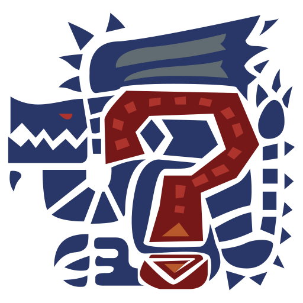

<div align="center">



# MUMH – Mix Up My Hunt

_A Monster Hunter Wilds randomizer that rolls the next hunt and a weapon for
every hunter._

[](CHANGELOG.md)
[](https://www.rust-lang.org/)
[](https://tailwindcss.com/)
[](https://alpinejs.dev/)
[](LICENSE)

[Overview](#overview) • [Features](#features) •
[Getting Started](#getting-started) • [Documentation](#documentation)

</div>

MUMH is a small static website for groups of one to four players who want to
shake up their Monster Hunter Wilds sessions: one click picks a random monster,
its temper level and whether to capture or kill it, and assigns every hunter a
random weapon.

## Overview

The site is generated once at build time and served as plain files, so it runs
on any static host and needs no backend. A Rust program renders the HTML from
templates and embeds the game data as JSON; all rolling happens in the browser.

The repository consists of the following parts:

- **Site generator** – reads the data files and renders `dist/`, built with
  [Rust](https://www.rust-lang.org/) and [Askama](https://askama.rs/). The code
  lives in `src/`.
- **Templates** – page layout, header, footer and the legal notice modal as
  Askama templates. The code lives in `templates/`.
- **Frontend** – roll logic, animations and persistence with
  [Alpine.js](https://alpinejs.dev/), styled with
  [Tailwind CSS](https://tailwindcss.com/). The code lives in `static/` and
  `tailwind.css`.
- **Game data** – monsters, weapons and translations as JSON. The data lives in
  `json/`.

## Features

- **Monster roll**: picks one of 39 monsters, including a temper level (normal,
  tempered, arch-tempered) the monster actually supports.
- **Hunt objective**: decides between capture and kill, capture only for
  capturable monsters.
- **Weapon roll**: assigns one of the 14 weapon types to each of up to four
  hunters with editable names.
- **Animated cards**: staggered slide animations; the roll button stays locked
  until every card has settled.
- **Two languages**: English and German, switchable at any time.
- **Remembered settings**: language, player count, names, weapons and the last
  monster survive a reload via `localStorage`.
- **Privacy-friendly**: no cookies, analytics or tracking; legal notice and
  privacy policy are built in.

## Getting Started

### Prerequisites

- [devenv](https://devenv.sh/) (provides Rust, Tailwind CSS 4 and Python 3)
- optionally [direnv](https://direnv.net/) to load the environment
  automatically

### Installation

```sh
git clone git@github.com:farbzen/mumh.git
cd mumh
```

### Build and run

```sh
devenv shell -- build   # Tailwind CSS + cargo run --release -> dist/
devenv shell -- serve   # http://localhost:8000
```

> [!IMPORTANT]
> The site generator aborts if `static/css/main.css` is missing. Always build
> the CSS first – the `build` script does both steps in the right order.

> [!TIP]
> Every published GitHub release is deployed to GitHub Pages automatically, see
> [Deployment](docs/deployment.md).

## Documentation

- [Development](docs/development.md) – project layout, build pipeline, scripts
- [Game data](docs/game-data.md) – adding monsters, weapons and languages
- [Deployment](docs/deployment.md) – GitHub Pages workflow
- [Changelog](CHANGELOG.md)

## License

See [LICENSE](LICENSE).

> [!NOTE]
> MUMH is a fan-made derivative work based on Capcom's Monster Hunter and not an
> official or Capcom-authorized product. The MIT License covers only the code of
> this project, not Capcom's intellectual property such as the monster and
> weapon images, which will be removed at Capcom's request.
